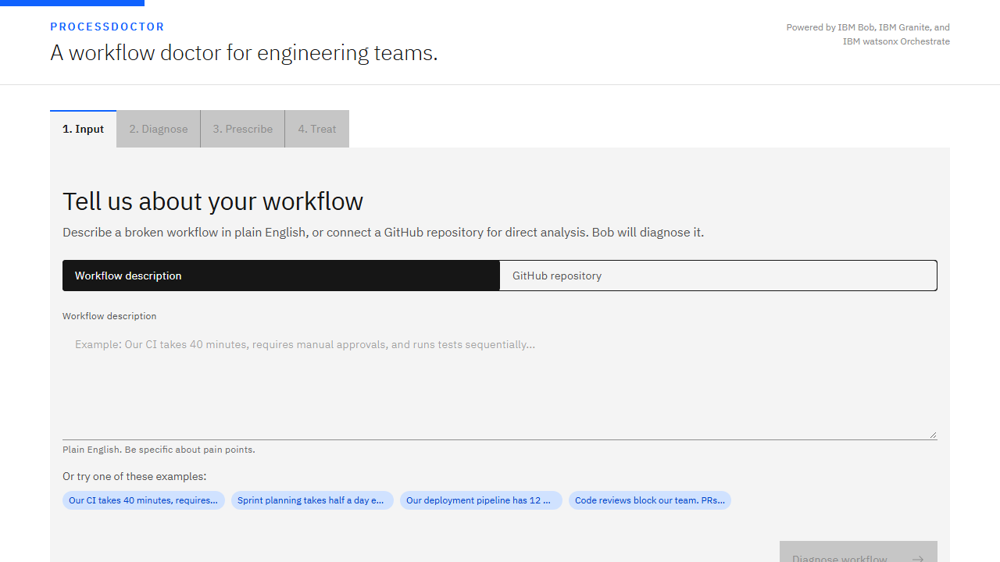
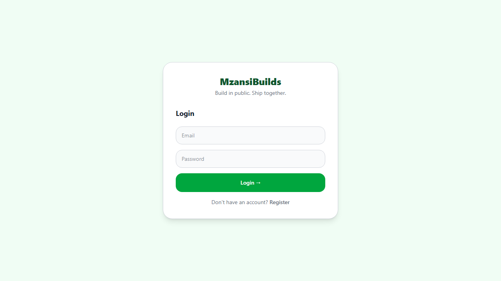
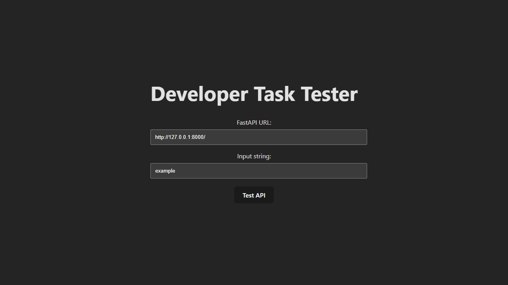

<h1 align="center">Hi, I'm Precious Magodi 👋</h1>

  <b>AI/ML & Software Engineer · Data Analysis & Business Insights · Building Intelligent, Impact-Driven Solutions</b>

  
  
  
  

  <a href="#about">About</a> •
  <a href="#tech">Languages & Technologies</a> •
  <a href="#projects">Featured Projects</a> •
  <a href="#private">Private Work</a> •
  <a href="#connect">Connect</a>

---

<h2 id="about">🙋🏽‍♀️ About me</h2>

I'm an AI/ML and full-stack engineer who enjoys turning research-grade ideas into production-ready systems — from fairness-aware admissions pipelines to real-time computer vision tools. I care about building AI that's **transparent, efficient, and actually useful**.

- 🎓 **BSc Hons Information Technology (AI)** — University of Johannesburg
- 🏅 **Moshal Program Alumna** · **Golden Key International Honour Society** Member
- 📄 **Published researcher** — presented at ISBM 2025
- 🌱 Currently certifying in **SQL & Business Analysis** (Signature Academy)

---

<h2 id="tech">🛠️ Languages & Technologies</h2>

<b>Languages</b>

  &nbsp;
  &nbsp;
  &nbsp;
  &nbsp;
  &nbsp;
  

<b>Web, Mobile & Backend</b>

  &nbsp;
  &nbsp;
  &nbsp;
  &nbsp;
  &nbsp;
  &nbsp;
  &nbsp;
  

<b>AI / ML & Data</b>

  &nbsp;
  &nbsp;
  &nbsp;
  &nbsp;
  &nbsp;
  &nbsp;
  &nbsp;
  &nbsp;
  

<b>DevOps & Tools</b>

  &nbsp;
  &nbsp;
  &nbsp;
  &nbsp;
  

---

<h2 id="projects">🚀 Featured Projects</h2>

<h3>🩺 ProcessDoctor — a workflow doctor for engineering teams</h3>

A Bob-powered workflow intelligence system that **analyses, optimises and automates** developer workflows, built on **IBM Bob, IBM Granite and watsonx Orchestrate** at the IBM Bob Dev Day Hackathon.

- 🔬 **Diagnose** — understands a workflow from plain English or a connected GitHub repo
- 💡 **Prescribe** — finds bottlenecks and designs an optimised workflow
- ⚙️ **Treat** — generates production-ready CI/CD pipelines and scripts
- 📈 Demo: a 40-minute sequential pipeline cut to **15 minutes**; MVP showed **50–70% workflow efficiency gains**

    

 

<h3>🧱 MzansiBuilds — build in public, ship together</h3>

A social platform for developers to **share progress, discover projects and collaborate**.

- 📰 **Live feed** of project updates with comments and collaboration requests
- 🤝 **Collaboration system** — request to join projects; owners accept or decline
- 🔄 **Project lifecycle** — Planning → Development → Testing → Completed
- 🎉 **Celebration Wall** for shipped projects and the teams behind them
- 🔐 JWT auth, bcrypt hashing, Pydantic validation and soft-delete audit trails

     

 

<h3>⚡ OneEleven Developer Challenge</h3>

A **FastAPI** POST endpoint paired with a **React** front end for testing and validating it end to end, deployed on Vercel.

   

---

<h2 id="private">🔒 Private Work — Highlights</h2>

These projects live in private repositories. Here's what they are — <b>reach out if you'd like a walkthrough, a demo, or more detail.</b>

<table>
<tr>
<td width="50%" valign="top">

### 🎟️ QueueMaster
Multi-tenant SaaS that **replaces physical queues**. Businesses run digital queues from a dashboard; customers join remotely with no account and track their position and wait time from their phone. Includes a platform-admin console for tenants, billing and system health, plus ZAR / Paystack / Stripe billing.

React 19 · Vite · Tailwind · DaisyUI · FastAPI · SQLAlchemy · MySQL · JWT

</td>
<td width="50%" valign="top">

### 🛡️ DeScam
Checks **SMS, WhatsApp messages, emails, links, phone callers, screenshots and news stories** for scams and misinformation — and explains every verdict in plain language. Shared TypeScript client package for web now and mobile next.

FastAPI · React · TypeScript · Vite · AI integrations

</td>
</tr>
<tr>
<td width="50%" valign="top">

### 🎓 ADMIT.AI
**Fairness-aware AI admissions platform** that processes **10,000+ applications in under 5 minutes**, with fairness monitoring built into the pipeline. Honours capstone — graduated with Distinction, selected for UJ Projects Day 2025.

Python · FastAPI · React · ML fairness

</td>
<td width="50%" valign="top">

### 🤟🏽 SASL Interpreter
Real-time **South African Sign Language recognition**. **Published at ISBM 2025.**

MediaPipe · TensorFlow · LSTM · OpenCV

</td>
</tr>
<tr>
<td width="50%" valign="top">

### 🤖 AI DevOps Assistant
A **production-ready AI DevOps assistant**, orchestrated with **LangGraph** and deployed on a containerised cloud stack.

FastAPI · React · LangGraph · Docker · MySQL · Redis · AWS

</td>
<td width="50%" valign="top">

### 🏊🏽‍♀️ AquaQual
**Action quality assessment for competitive diving** — scores dives using Temporal Convolutional Networks, deployed via ONNX. Built for a biometrics module.

Python · TCNs · ONNX

</td>
</tr>
<tr>
<td width="50%" valign="top">

### ⚽ Football Set-Piece Simulator
Kicker and goalkeeper **reinforcement-learning agents** that learn penalty strategy in a visual simulator, with sensors, actuators and swappable algorithms.

Python · PyGame · Q-Learning · PPO · DDPG

</td>
<td width="50%" valign="top">

### ❤️ Heartbeats by Hand
A **Variational Autoencoder built from scratch in NumPy** for ECG anomaly detection on the MIT-BIH dataset, with a React visualisation layer.

NumPy · VAE · React

</td>
</tr>
<tr>
<td width="50%" valign="top">

### 🔬 PostDoc Sphere
Final-year project, **team lead**. A web platform with a companion mobile app that automates research-fellowship workflows.

React · Node.js · Flutter · Dart

</td>
<td width="50%" valign="top">

### 🏥 Health Connect
E-health platform that **predicts patient illness likelihood from symptoms**. **Top 5 finalist, NEMISA Datathon.**

Python · Django · ML

</td>
</tr>
<tr>
<td width="50%" valign="top">

### 📊 Gmail → Excel Automation
Pipeline that pulls Excel attachments from Gmail, extracts the selected data and builds **consolidated monthly reports**, with a small Streamlit UI for manual runs and previews.

Python · Gmail API · Excel · Streamlit

</td>
<td width="50%" valign="top">

### 💼 Intelligent Portfolio
Personal portfolio with an **AI chat assistant grounded in my own project data**, moving to a MySQL → FastAPI → React production stack.

JavaScript · React · FastAPI · MySQL

</td>
</tr>
</table>

  <b>Want to see any of these in action?</b>  
  
  

---

<h2 id="connect">📫 Let's connect</h2>

  
  

💬 Ask me about **fairness in AI**, **computer vision**, or how to **turn a research paper into a working product**.
